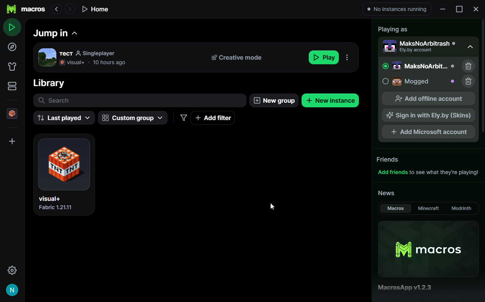
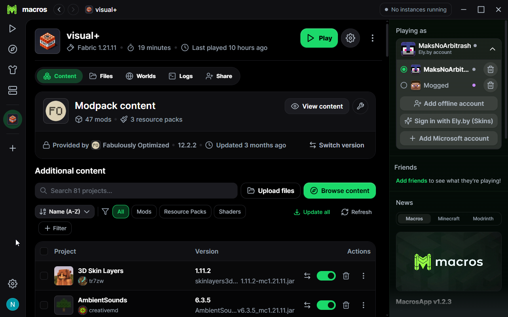
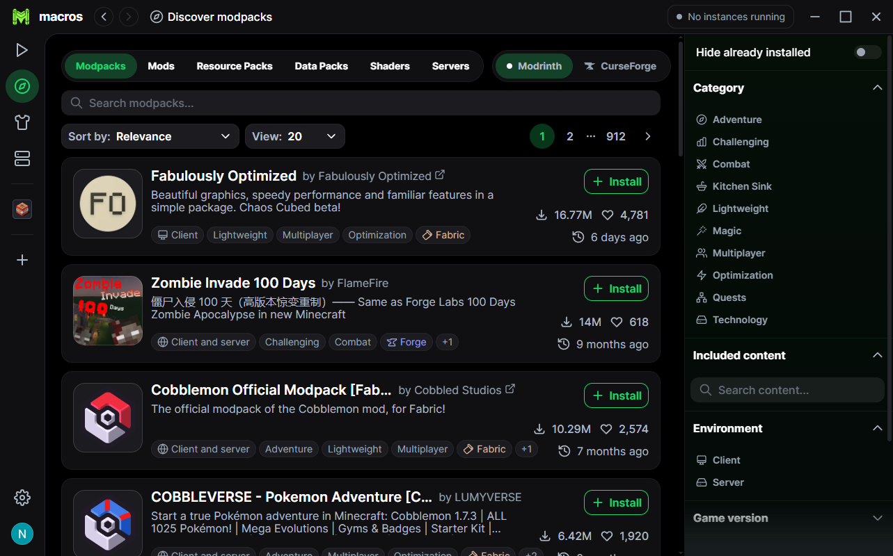
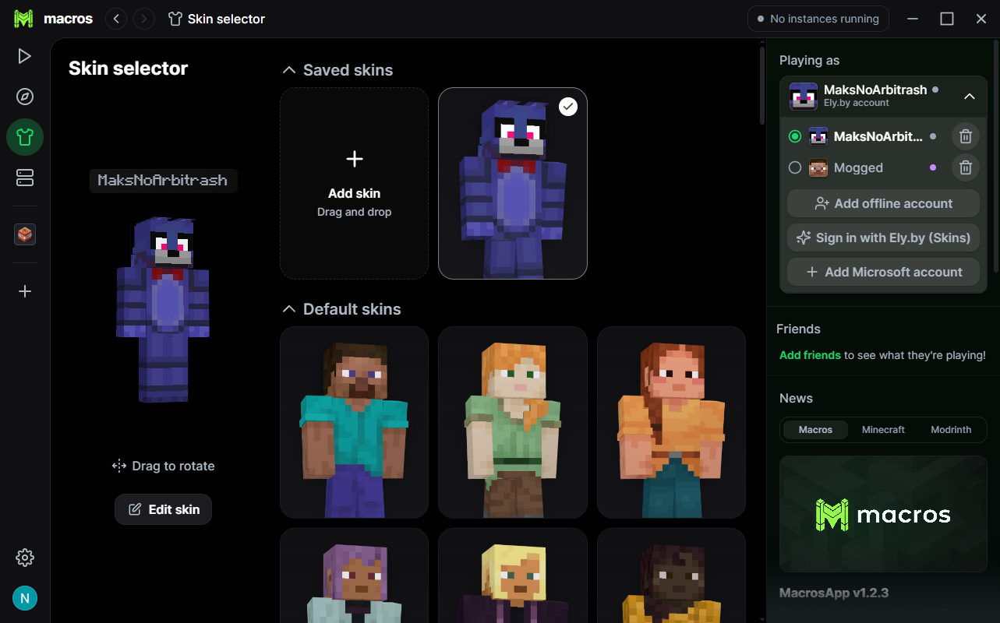

# MacrosApp 🎮

[](https://github.com/nnnegrvpeni-lang/MacrosApp/releases/tag/v1.2.5)
[](COPYING.md)
[](https://github.com/nnnegrvpeni-lang/MacrosApp/releases/tag/v1.2.5)
[](https://modrinth.com)

**MacrosApp** is a fast, lightweight, and modified fork of the **Modrinth App** with native support for the official **Modrinth ecosystem**, **Ely.by** skins and accounts, **Offline mode (No-Auth)**, unified **CurseForge** catalog browsing, **custom accent colors**, **Discord Rich Presence**, and a completely **ad-free** experience.

> 🇷🇺 **MacrosApp** — быстрый и легкий лаунчер Minecraft на базе Modrinth App с нативной поддержкой экосистемы **Modrinth**, аккаунтов и скинов **Ely.by**, **офлайн-режима (без аккаунта Microsoft)**, встроенным каталогом **CurseForge**, кастомизацией тем и полным отсутствием рекламы.

---

## ✨ What's in MacrosApp v1.2.5 / Что нового в v1.2.5

### 🎨 Brand Accent Color Customization (Выбор акцентного цвета)
- **8 Modern Presets**: Быстрый выбор тем в один клик: *Modrinth Green* (по умолчанию), *Cyan*, *Electric Blue*, *Purple*, *Magenta*, *Coral*, *Amber*, *Emerald*.
- **Custom Hex Picker**: Свободный выбор любого цвета из нативной палитры (`Настройки` → `Внешний вид` / `Settings` → `Appearance`).
- **Dynamic Luminance & Contrast**: Лаунчер динамически рассчитывает оптимальный контраст текста и оттенки при наведении для идеальной читаемости.
- **Reactive Live Preview**: Мгновенное обновление CSS-переменных без перезапуска лаунчера.

### 👕 3D Skin & Cape Preview Bugfix (Исправление 3D-предпросмотра скинов)
- **Устранены пустые карточки скинов**: Исправлена ошибка, из-за которой сохраненные скины отображались пустыми.
- **Удалены устаревшие запросы плащей**: Исключены недействительные вызовы Ely.by плащей, вызывавшие сбои рендера.
- **WebGL Fallback**: Автоматический переход на 2D-аватар при сбоях 3D-контекста.

---

## 🌟 Key Features / Ключевые возможности

### 🌿 Native Modrinth Ecosystem / Экосистема Modrinth
- Прямая интеграция с официальным каталогом **Modrinth** — моды, модпаки, ресурспаки, шейдеры.
- Бесшовная авторизация Modrinth через встроенное окно OAuth с автозахватом сессии без ручного копирования токенов.

### 🦊 Native Ely.by Integration / Интеграция Ely.by
- **Безопасная OAuth2-авторизация**: Вход через сайт Ely.by по коду подтверждения — пароль не передается лаунчеру.
- **Скины и плащи в игре**: Полное отображение скинов и плащей других игроков через официальную библиотеку `by.ely:authlib`.
- **Предпросмотр в лаунчере**: 2D и 3D рендеринг скинов и плащей в сайдбаре и меню выбора профиля.

### 🎮 Offline Accounts (No-Auth) / Офлайн-аккаунты
- Запуск игры под любым кастомным никнеймом без учетной записи Microsoft.
- Корректная генерация Java Offline UUID (`MD5("OfflinePlayer:" + username)`).
- Быстрое переключение между Microsoft, Ely.by и Офлайн-профилями.

### 📦 Unified Catalog: Modrinth + CurseForge / Каталог модов
- Переключение источников **Modrinth / CurseForge** прямо в интерфейсе поиска.
- Поиск, фильтрация по версиям и загрузчикам (Fabric, Forge, NeoForge, Quilt) и установка в один клик.

### 🔔 Smart Update Notifications / Умные уведомления
- Ненавязчивая проверка обновлений через GitHub Releases API.
- Плавные стартовые toast-уведомления и индикатор обновлений в шапке.

### 💬 Discord Rich Presence
- Отображение активного экземпляра, версии игры и времени в реальном времени в Discord.

### 🚫 100% Ad-Free / Без рекламы
- Никаких видеоплееров, всплывающих окон и промо-баннеров.
- Чистый, минималистичный и отзывчивый интерфейс.

---

## 📸 Screenshots

| 🖥️ Главный экран | 📦 Файлы и сборки |
| :---: | :---: |
|  |  |
| **🔍 Каталог Modrinth & CurseForge** | **👕 3D кастомизация скинов** |
|  |  |

---

## 📥 Download / Скачать

Готовые сборки для Windows:

👉 **[Скачать MacrosApp v1.2.5 (GitHub Releases)](https://github.com/nnnegrvpeni-lang/MacrosApp/releases/tag/v1.2.5)**

- **`Macros_1.2.5_x64-setup.exe`** — Официальный Windows-установщик (NSIS).
- **`MacrosApp.exe`** — Портативная версия (не требует установки).

---

## 🛠️ Building from Source / Сборка из исходников

### Prerequisites / Требования
- **Node.js** (v20+)
- **pnpm** (`npm install -g pnpm`)
- **Rust** (stable toolchain)

### Build Steps / Инструкция по сборке
```bash
# 1. Клонирование репозитория
git clone https://github.com/nnnegrvpeni-lang/MacrosApp.git
cd MacrosApp

# 2. Установка зависимостей
pnpm install

# 3. Сборка приложения и установщика
pnpm --filter @modrinth/app build
```

Готовые исполняемые файлы создаются в:
- `target/release/bundle/nsis/Macros_1.2.5_x64-setup.exe` — Windows installer
- `target/release/Macros.exe` (или `MacrosApp.exe`) — Standalone binary

---

## 📜 License

MacrosApp is open-source software licensed under the **GNU General Public License v3.0 (GPLv3)**. See [COPYING.md](COPYING.md) for full license details. Upstream Modrinth App codebase is developed by the Modrinth team.
